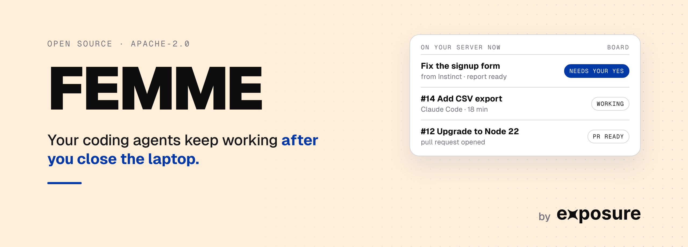
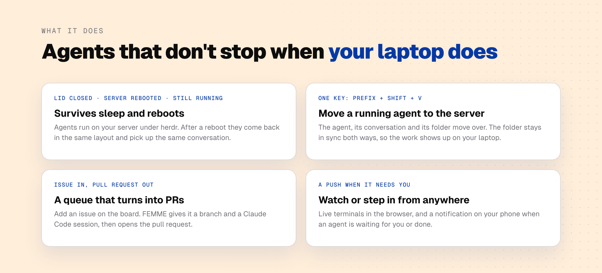
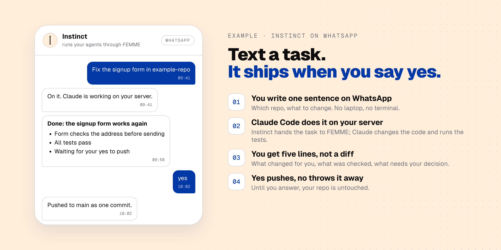
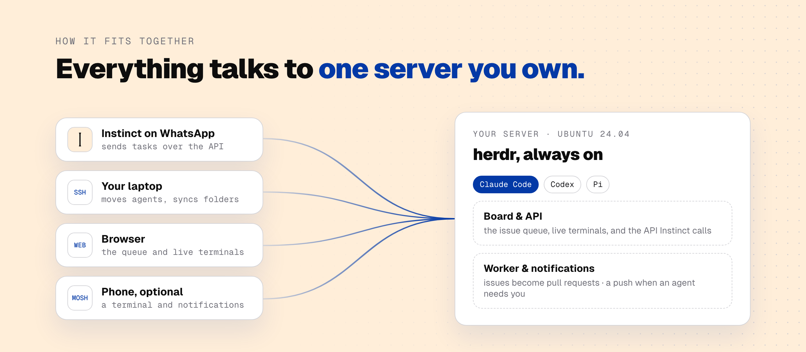
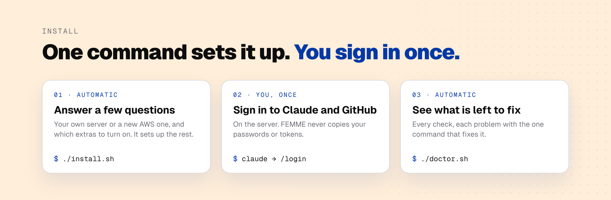
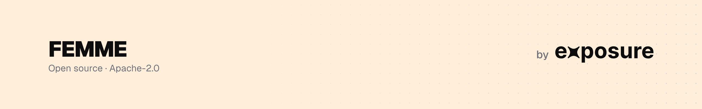

<picture>
  <source media="(prefers-color-scheme: dark)" srcset="assets/banner-dark.png">
  
</picture>

<p align="center">
  <a href="LICENSE"></a>
  
  
  
</p>

FEMME runs coding agents (Claude Code, Codex, Pi) under [herdr](https://herdr.dev) on a server you own, so they keep working while your laptop sleeps. You reach them over SSH, in a web board, or through an HTTP API that bots like Instinct use. It is a set of shell scripts, systemd user services and one small Rust server; nothing is exposed to the internet unless you turn it on.

<p align="center">
  <a href="#quick-start">Quick start</a> ·
  <a href="docs/api.md">Use it from WhatsApp</a> ·
  <a href="docs/install.md">Install guide</a> ·
  <a href="#docs">Docs</a>
</p>

<picture>
  <source media="(prefers-color-scheme: dark)" srcset="assets/features-dark.png">
  
</picture>

## Example: Instinct on WhatsApp

We run FEMME this way. We write to [Instinct](https://instinct.com/) on WhatsApp: "fix the signup form in our repo". Instinct hands the task to FEMME through its API. Claude Code does the work on the server, checks it and writes a short report in plain words. Instinct sends us the report, and nothing is pushed until we answer "yes". No laptop and no terminal needed.

<picture>
  <source media="(prefers-color-scheme: dark)" srcset="assets/instinct-dark.png">
  
</picture>

Any bot or agent can do the same with an API key: see [API](docs/api.md) and the [minimal client](examples/api-client.sh).

## How it fits together

<picture>
  <source media="(prefers-color-scheme: dark)" srcset="assets/architecture-dark.png">
  
</picture>

- **Agents keep running.** herdr runs as a service that starts at boot. Terminals survive SSH drops and lid closes; after a reboot herdr restores the layout and resumes the agents' conversations.
- **Move an agent to the server.** One key in herdr forks a local agent, with its conversation and folder, onto the server. The folder then stays in two-way sync.
- **Board and API.** An issue queue that agents turn into pull requests, live terminals, sessions, and the API that bots use.
- **Notifications** on your phone when an agent needs you or is done.

## Quick start

<picture>
  <source media="(prefers-color-scheme: dark)" srcset="assets/install-dark.png">
  
</picture>

On your laptop (Linux or macOS):

```sh
git clone <this repo> femme && cd femme
./install.sh
```

It asks where FEMME should run (an Ubuntu 24.04 server you have, a new AWS instance, or this machine) and which optional parts you want. Then it prepares the server, installs everything and checks it. **You** bring the server and sign in on it once (`claude` → `/login`, `gh auth login`). The [install guide](docs/install.md) lists exactly what is automatic and what is not.

Afterwards: `./doctor.sh` checks everything, `./install.sh update` updates, `./uninstall.sh` takes it off.

## Docs

| | |
|---|---|
| [Install](docs/install.md) | where it can run, what `install.sh` does, the board private or public, by hand |
| [API & Instinct](docs/api.md) | use FEMME from a chat bot or another agent; a [minimal client](examples/api-client.sh) |
| [Laptop](docs/laptop.md) | forking agents, folder sync, drop box, building on the laptop with `pc` |
| [Board](docs/board.md) | issues, terminals and sessions in the browser |
| [Phone](docs/phone.md) | optional: a terminal and notifications on the phone |
| [Claude accounts](docs/accounts.md) | the accounts window, optional rotation between accounts |
| [AWS](docs/aws.md) | the optional instance role, a spend brake |
| [Troubleshooting](docs/troubleshooting.md) | common errors and their fixes |
| [Costs](docs/costs.md) | what you pay for, what is optional |
| [Contributing](CONTRIBUTING.md) | how the pieces fit, how to change them |

## Requirements

- **Laptop:** Linux or macOS with `ssh`, `rsync`, `jq`, `git`, `curl`. herdr and [Mutagen](https://mutagen.io) only for forking agents and folder sync.
- **Server:** Ubuntu 24.04 on x86_64 or arm64, reachable over SSH, with a user that can `sudo`; or an AWS account, and `provision.sh` makes one.
- **Accounts:** Claude (for Claude Code) and GitHub. Optional: Codex or Pi, a domain and Resend for a public board.

## Security

Agents on the server run without permission prompts, and anything running as your user there can use what the server can reach. The parts that widen that (public board, AWS role, auto-deploy, account rotation) are off until you turn them on. Read [SECURITY.md](SECURITY.md) before you do.

## License

Apache-2.0, see [LICENSE](LICENSE). FEMME builds on [herdr](https://herdr.dev) and other tools it installs but does not include; see [NOTICE](NOTICE). The Exposure name and logos are trademarks of Exposure and are not covered by the license.

<picture>
  <source media="(prefers-color-scheme: dark)" srcset="assets/footer-dark.png">
  
</picture>
