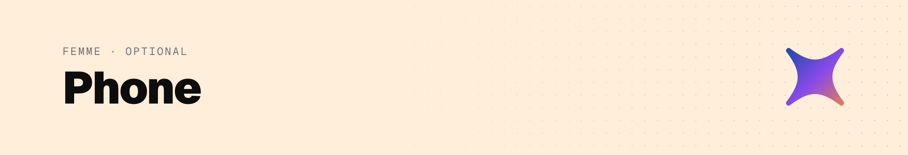

<picture>
  <source media="(prefers-color-scheme: dark)" srcset="../assets/docs-phone-dark.png">
  
</picture>

A terminal on the phone, for when you want to watch or type into the agents yourself.

1. Install **Moshi** (or Blink Shell) and **ntfy**.
2. In Moshi, generate a key and copy the public key. On the laptop: `ssh agentbox 'cat >> ~/.ssh/authorized_keys'`, paste, Ctrl-D.
3. Add host: `<your user>@<IP from .env>`, mosh on, command `herdr`.
4. In ntfy, subscribe to the `NTFY_TOPIC` from `.env`. Anyone who knows the topic can read your pushes, so keep it secret.
